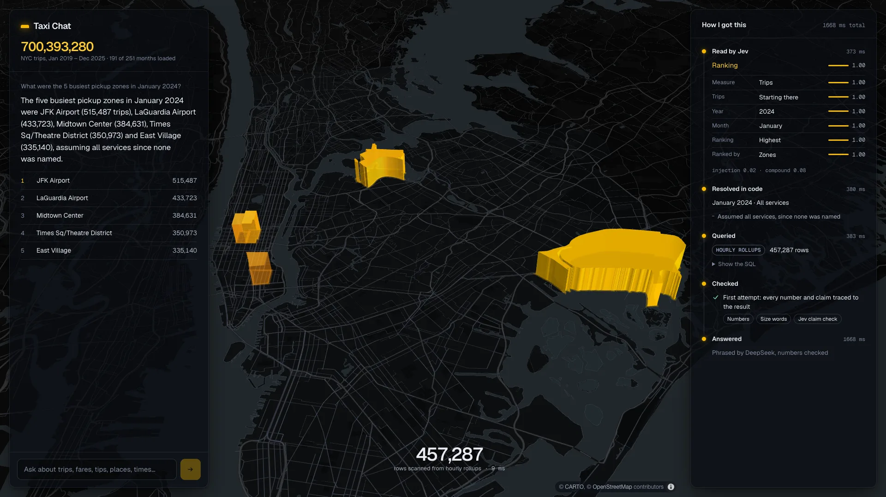
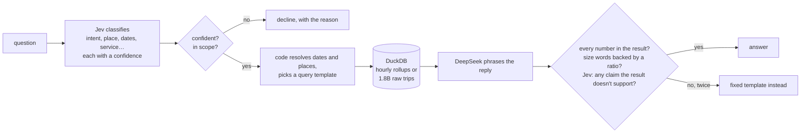
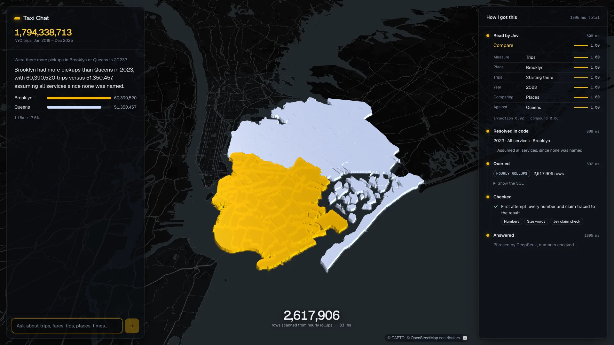
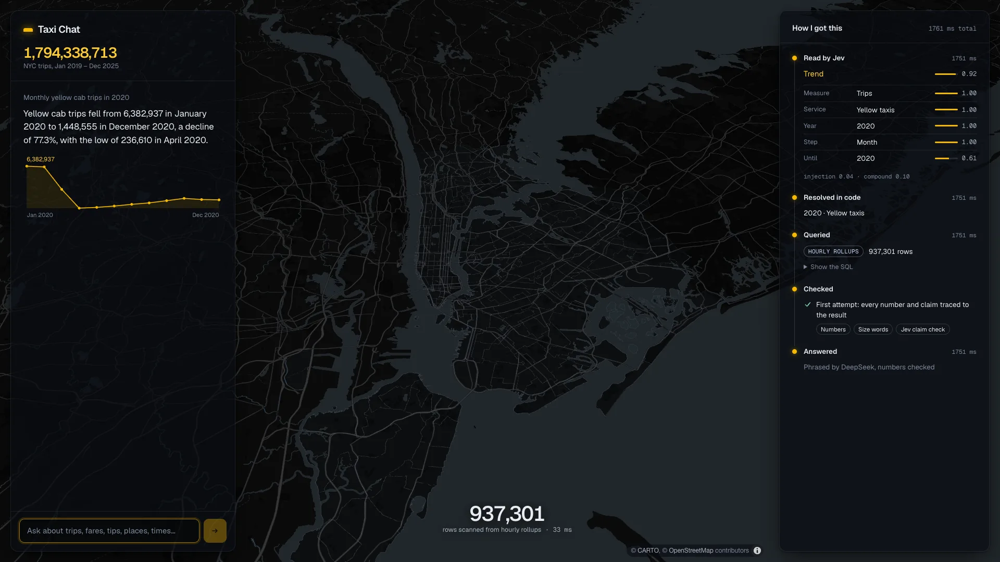
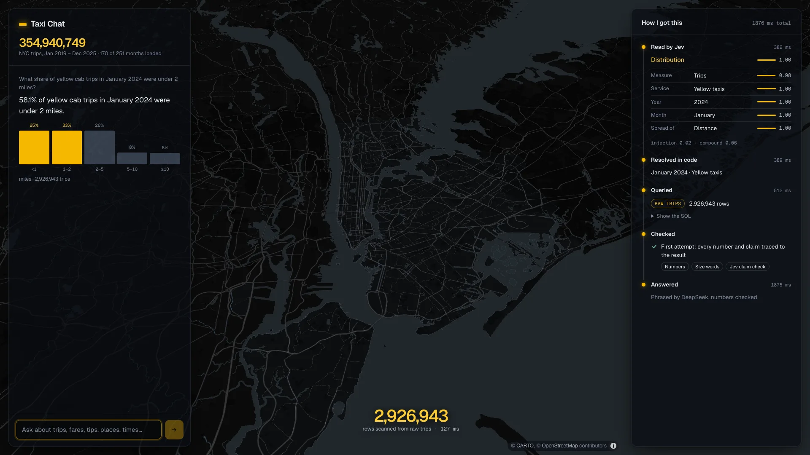
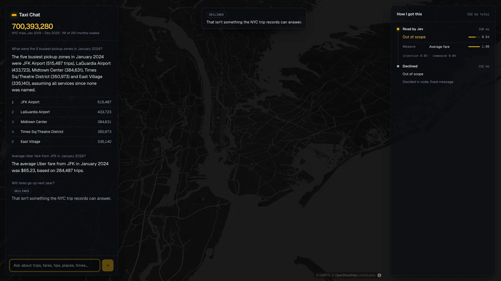

# Taxi Chat

A chatbot over every NYC taxi and rideshare trip from 2019 to 2025, all
1,794,338,713 of them, that would rather decline than guess.

On 46 held-out questions written by a person who never tried them on the bot
first, it answered 30 of 33 correctly and declined all 12 it should have,
including a prompt injection. It gave no answers it should have refused. All
three wrong answers came from one bug: New Year's Eve 2021 was a Friday, and
the small hours of that night were counted in 2022. The held-out run is what
found it.

[](docs/demo.mp4)

[Watch the 48-second demo](docs/demo.mp4): a ranking, a comparison, a trend,
and a question it declines.

## How it stays honest

Every number in a reply comes from a SQL query the page shows you, and every
reply is checked before you see it.



- **Jev decides; code computes.** [Jev](https://docs.typesafe.ai) is a
  classification model that returns calibrated probabilities instead of text. It
  picks the question type, place, service, time of day and date parts from
  closed lists. Code turns those into a query. Dates, arithmetic and place
  matching never go through a language model, because Jev's own docs say it's
  unreliable at them.
- **Low confidence means decline.** Each decision carries a confidence, and
  thresholds tuned on separate questions decide when to answer. A vague question
  that's answerable gets stated defaults ("assuming all services, since none was
  named"); an unclear one gets declined with the reason.
- **The language model only phrases.** DeepSeek writes one or two sentences
  from the query result. A checker rejects any number not in the result
  (rounding allowed, "about 40 million" for 41.2 million not), any "doubled" or
  "tripled" not backed by a ratio computed in code, and anything Jev judges the
  result doesn't support. Two failures and the reply is a fixed template.
- **Five kinds of question, single-turn:** totals and averages, rankings,
  trends, comparisons, and distributions. Everything else is declined, including
  questions about drivers, ratings, weather, predictions and single trips.

## Results

Thresholds were tuned on one set of questions and measured once on another.

| | Tuning (193) | Held out (46) |
|---|---|---|
| Correct answers | 148 | **30** |
| Wrong answers | 1 | **3** (one bug, see above) |
| Answerable but declined | 2 | 1 |
| Should be declined, and were | 42 of 42 | **12 of 12** |
| Should be declined, but answered | 0 | **0** |
| Correct of answered | 99.3% | **90.9%** (target was 97%) |
| Latency p50 / p95 | 1.43 s / 1.88 s | 1.39 s / 2.18 s |

- **The test set.** 72 seed questions across all five question types plus
  should-decline cases, each with a correct answer computed by hand-written SQL
  over the raw trips, never through the bot's templates or rollups. 12 of the
  seeds were written by Patrick without trying them on the bot; those and their
  rewordings are the held-out set. Rewordings (typos, slang, "Billyburg",
  relative dates) were generated by DeepSeek, meaning-checked by a second model,
  and reviewed by hand. 11 were dropped as duplicates or reinterpretations.
- **Tuning.** 210 threshold combinations were swept over the tuning set. The
  chosen point answers the most questions correctly among points where it *and
  every neighbouring setting* reach 97% with zero answers that should have been
  declined, so it doesn't depend on a lucky edge.
- **The held-out run happened once**, at commit `1cc1d24`; its full output is
  in [`eval/results/holdout.json`](eval/results/holdout.json). The New Year bug
  it found has since been fixed with regression tests. The held-out numbers
  above are from before the fix and weren't re-run.
- **Option order.** Jev's docs warn it can favour the first option. Shuffling
  every option list changed 14 of 2,560 answers (0.5%), all at confidence 0.75
  or below, where the gate already declines or falls back to a default.
- **Cost:** about $0.0003 per question (Jev about $0.00016, DeepSeek about
  $0.00012, at DeepSeek's peak rates).

## The data

NYC Taxi & Limousine Commission trip records for yellow taxis, green taxis and
high-volume rideshare (Uber, Lyft), January 2019 to December 2025.

| | Trips |
|---|---|
| Yellow | 303,271,778 |
| Green | 11,921,164 |
| Rideshare | 1,479,145,771 |
| **Kept** | **1,794,338,713** |
| Rejected | 6,157,770 (0.34%) |

- **Seven years of schema drift handled in one place:** a renamed fee column,
  INT32/INT64/DOUBLE changes, and a new congestion fee in 2025.
- **Every rejected row is counted by reason.** Most are refunds and voids
  (5.96M negative amounts); the rest are dropoffs before pickups, impossible
  distances, trips filed in the wrong month, and trips over 24 hours.
- **The hourly rollups reconcile exactly** with the raw rows: trip counts match
  for every service, and dollar totals match an exact decimal sum to the cent.
- **Sizes:** 40 GB downloaded, 21 GB cleaned, 785 MB of rollups. Rankings and
  totals come from the rollups in milliseconds; distributions and drop-off
  questions scan the raw trips (22.6M trips in about 0.2 s, a full year in a
  few seconds).

## What it won't do

- Follow-up questions, or anything outside the five question types.
- Joins to other data (weather, events), or questions about one trip or person.
- Run live anywhere. The demo is the recording; the data stays local.

Known limits: the held-out set is small (33 answered questions), so read the
percentages as counts. Latency was measured on one Apple M1 Max laptop. In
comparisons, the trace panel's summary names only the first place compared.

## Running it

```sh
uv sync

# Data (about 40 GB to download, an hour or so)
uv run python -m pipeline.download --from 2019-01 --to 2025-12
uv run python -m pipeline.normalise --from 2019-01 --to 2025-12
uv run python -m pipeline.rollup --from 2019-01 --to 2025-12
uv run python -m pipeline.report

# Tests: run offline against recorded Jev and DeepSeek responses
uv run pytest

# Interface. Keys go in .env: TYPESAFE_API_KEY, and DEEPSEEK_API_KEY for
# phrased replies (without it, replies come from the fixed templates).
cd web && npm ci && npm run build && cd ..
uv run --env-file .env uvicorn taxichat.server:app   # http://127.0.0.1:8000

# Benchmark
uv run python -m eval.gold                            # correct answers from the raw trips
uv run python -m eval.run tune                         # replays the committed Jev cache
uv run --env-file .env python -m eval.run report       # tuning set, live
```

For work on the interface, run the API as above and `npm run dev` in `web/`;
Vite proxies `/api` to port 8000. `TAXI_DATA_DIR` points the server at a data
directory other than `data/`.

The zone shapes in `web/public/zones.geojson` are NYC TLC's taxi zone
boundaries (NYC Open Data), reprojected to WGS84 and simplified with mapshaper.
The basemap is CARTO's Dark Matter (© CARTO, © OpenStreetMap contributors).

## Screenshots

| | |
|---|---|
|  |  |
|  |  |

## Licence

MIT. See [LICENSE](LICENSE).
